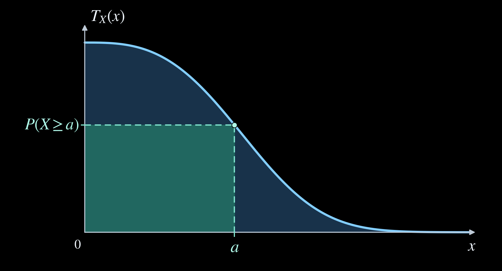
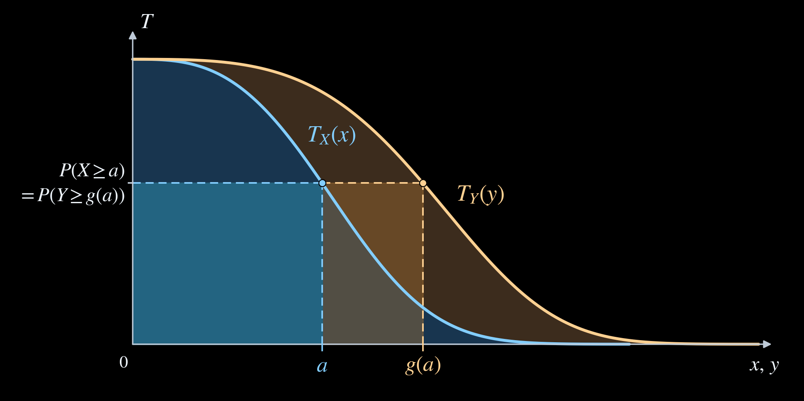
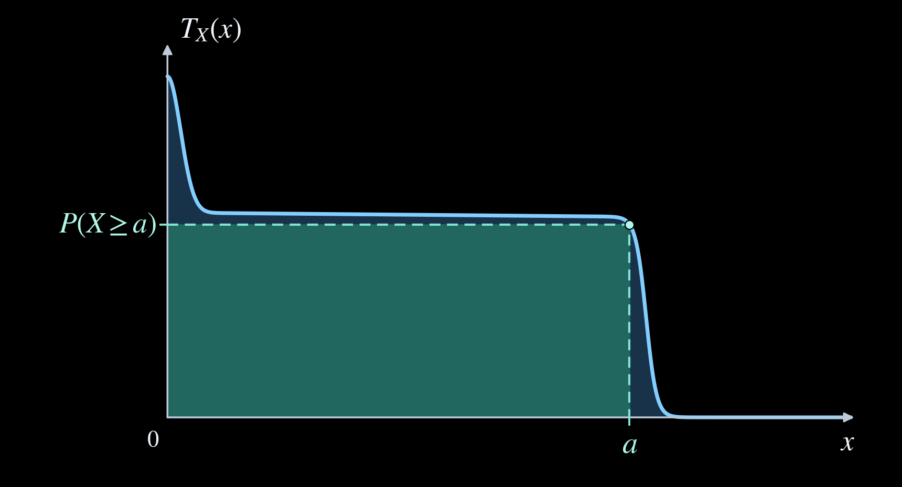
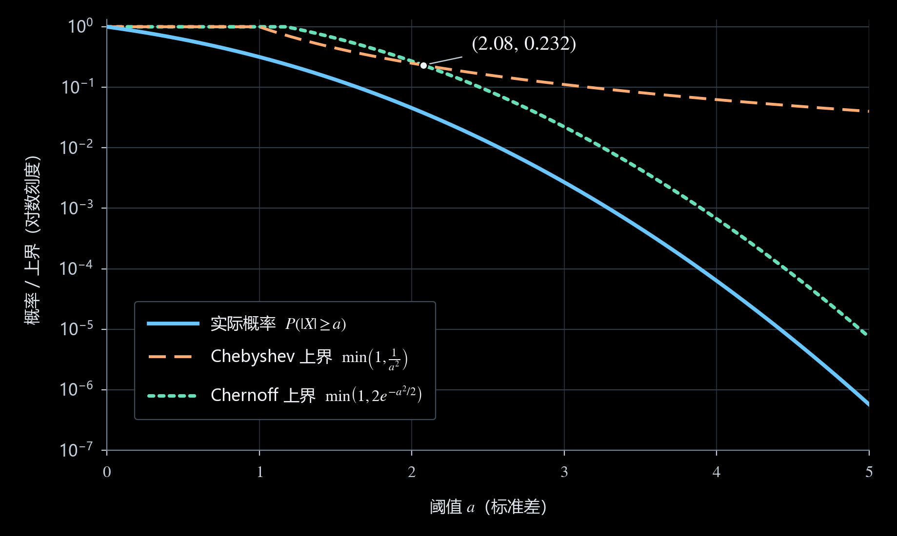
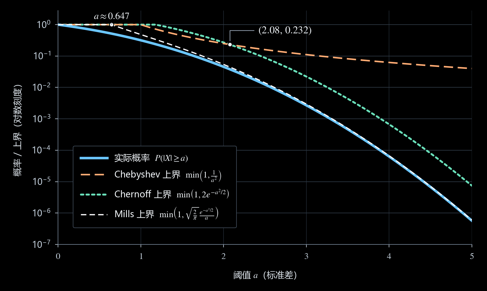

## 前言
学习概率论时到了集中不等式一章，老师介绍了 Chernoff 界技术和利用它得到指数下降的尾概率估计。但是这看着很玄乎，为什么给原分布取个指数，再引入一个调整参数，就能将估计的精确程度提高一大截呢？为什么我们选择的又是指数函数，而不是其他更极端的函数？这问题困扰了我相当的时间，于是决定花一些工夫把这件事弄清楚。
## 尾概率
我们引入尾概率分布 $T_{X}(x)=P(X\geq x)$.
对一个期望存在的连续随机变量 $X\geq 0$，有尾概率公式
$$
\begin{align*}
E[X] & =\int_{0}^{+\infty}xf_{X}(x)\,dx \\
 & =\int_{0}^{+\infty} -x \, d(1-F_{X}(x))  \\
 & =\underbrace{ -x(1-F_{X}(x))\mid_{0}^{+\infty} }_{ 0 }+\int_{0}^{+\infty} (1-F_{X}(x)) \, dx  \\
 & =\int_{0}^{+\infty} P(X>x) \, dx .
\end{align*}
$$
该公式的成立并不依赖于 $X$ 的连续性，对于离散变量和其他更复杂的情况也是适用的（离散情况容易验证；其他情况需要更统一的测度理论来解释）。
再由数学分析的知识，可以证得
$$
E[X]=\int_{0}^{+\infty}P(X>x)\,dx=\int_{0}^{+\infty}P(X \geq x)\,dx=\int_{0}^{+\infty} T_{X}(x) \, dx .
$$
在概率不等式中，大于等于号会带给我们更加优秀的界限，它比大于号多包括一个端点。
显而易见，尾概率有如下基本性质：
- $T_{X}(0)=1.$
- $T_{X}(x)$ 单调递减。
- $\lim_{ n \to +\infty }T_{X}(x)=0$.
## Markov 不等式
考虑非负变量的 Markov 不等式
$$
aP(X\geq a) \leq E[X],
$$
它用尾概率表达即为
$$
aT_{X}(a)\leq \int_{0}^{+\infty}T_{X}(x)\,dx.
$$
这一等式具有明显的几何意义：左侧是 $T_{X}(x)$ 曲线上 $x=a$ 这一点与坐标轴确定的矩形的面积；右侧则是整个曲线下的面积。

因此我们可以轻松地量化 Markov 不等式估计概率的精确程度：
$$
p=\frac{P_{\text{真}}(X\geq a)}{P_{\text{估}}(X\geq a)}=\frac{aT_{X}(a)}{\int_{0}^{+\infty} T_{X}(x) \, dx }=\frac{S_{\text{矩形}}}{S_{\text{曲线}}}\in[0,1].
$$
这个占比越高，则估计效果越好。
## 对随机变量作变换
我们考虑 $Y=g(X)$. 为了让概率计算简便，我们假设 $g(x)$ 是一个单调增且非负的函数。那么概率估计问题就可以进行变换
$$
P(X\geq a)=P(Y\geq g(a)).
$$
同时，
$$
T_{Y}(y)=T_{X}(g^{-1}(y)).
$$
对于 $Y$ 同样可以使用 Markov 不等式，我们会得到另外一组“曲线——矩形”的图像，给出不同的精确程度。

注意两图的矩形高度必然一致，因为高度就是真实概率。
于是一个灵感在此迸发了：如果我们能找到一个优秀的变换 $g(x)$，**在变换后曲线下面积有限（也就是说 $E[g(X)]$ 存在/作为反常积分收敛）的前提下**，让它同时满足：
- **变换后计算 $E[g(X)]$ 尽可能地简单；**
- **变换后矩形占曲线的面积比例 $p$ 要尽可能地大；**
那不就能把 Markov 不等式变成一个非常精确的估计了吗？

在下文我们会看到，Chernoff 界技术就是这两种因素的一个极好的平衡。
如果考虑追求计算简单的极端，那当然就是 Markov 不等式；
要追求面积占比大，那我们可以用一段精心设计的“双L”状曲线，几乎紧贴着固定高度矩形的边缘：

这个估计看起来非常准确。
但直观上这样的变换要以 $a$ 为参数动态调整，构造它并不简单，对它计算期望更是十分折磨；这可能还不如直接操作原来的分布。
## 正态分布的尾概率估计
我们考虑标准正态分布变量 $X\sim \mathcal{N}(0,1)$，$E[X]=0$. 然而 $X$ 不是非负的，简单起见，我们的估计目标定为 $P(X^{2}\geq a^{2})$，它等于 $2P(X\geq a)$.
直接使用 Markov 不等式，实际上我们得到 Chebyshev 不等式
$$
P(X^{2}\geq a^{2})\leq \frac{E[X^{2}]}{a^{2}}=\frac{Var(X)}{a^{2}}=\frac{1}{a^{2}}.
$$
它的结果以多项式的速度趋于零。
使用 Chernoff 界考察正态分布得到
$$
X\sim \mathcal{N}(0,1),P(X\geq a)\leq e^{-a^{2}/2},
$$
则有
$$
P(X^{2}\geq a^{2})\leq 2e^{-a^{2}/2},
$$
它的结果以超越指数的速度趋于零。

实际列出不同范围的概率推测与实际尾概率的对数图表。

出乎我们的意料，Chernoff 界并没有那么精确。它的精确度 $p$ 并不高（图片范围内大约 $10^{-1}$），并且还在随着 $a$ 的增大逐渐减小；而且在约 $a<2.08$ 以内，它的估计值还不如朴素的 Chebyshev.
这是因为，为了计算简便我们做出了两项权衡：
- **不再要求所有情况都更好，只要求情况趋于极端时更好；**
- **不再要求 $p$ 值随着情况趋于极端绝对更好，只需要估计概率趋于零的速度更快。**

这也提醒我们，Chernoff 界或者其他高级不等式并不是一个在所有情况下都最佳的估计，它是专为极端情况设计的。在情况不那么极端时，朴素的 Markov、Chebyshev、Cantelli 等不等式反而可能会得到更好的结果。
## 参数的意义
在 Chernoff 方法中，我们并不是直接作一个指数，而是留出了一个自由度 $Y=e^{tX}$. 从结果的角度这很容易理解：对所有的 $t>0$ 取下界，可以得到一个最好的结果。
可是这不能解决对于过程的疑惑：为什么引入它？又为什么在这个位置？
我们试着不对参数最优化，直接使用 $Y=e^{tX}$，其中 $t$ 是某个常数。
那么对应的 Markov 界为
$$
P(e^{tX}\geq e^{ta})\leq \frac{E[e^{tX}]}{e^{ta}}.
$$
$E[e^{tX}]$ 是一个常数，那么无论 $t>0$ 取多少，这个结果还是以指数速度趋于零的，这当然还是优于 Chebyshev 方案的多项式速度。因此这也是一种可行的方案，而且也相当优秀。
要理解对 $t$ 取最小值这一步，我们回到刚才的目标，也就是给出“更好的估计值变化”，也就是尽可能降低等式右侧的阶数。
而根据正态分布的性质我们有
$$
E[e^{tX}]=e^{t^{2}/2},
$$
因此这个阶数的最小化也就是 $e^{t^{2}/2-ta}$ 的最小化，可以通过二次函数最小化简单地计算出来。
## 函数的选择
一旦我们改变了目标，这个问题立刻就变得容易解决了。如果我们有一个增长率超级高的函数 $g(X)$，那么对它估计就有
$$
P(g(X)\geq g(a))\leq \frac{E[g(X)]}{g(a)}
$$
它至少以 $g(a)$ 的速度趋于零，这个速度想要多快就有多快（更别提我们还可以和 Chernoff 一样给 $g$ 加上参数 $t(a)$）！
直观上看，这样一个增长率超高的函数会极大地放大尾部那一丁点的概率，从而为我们的估计提供方便。
实际上也是能更好的。对于上文标准正态分布的例子，你可以看到 Chernoff 距离渐进最优（与实际函数的差对数等距）明显还有些距离。实际上，用正态分布的 Mills 不等式
$$
\begin{align*}
P(X^{2}\geq a^{2}) & =\sqrt{ \frac{2}{\pi} }\int_{a}^{+\infty} e^{-x^{2}/2} \, dx  \\
 & \leq \sqrt{ \frac{2}{\pi} }\int_{a}^{+\infty} \frac{x}{a}e^{-x^{2}/2} \, dx  \\
 & =\sqrt{ \frac{2}{\pi} } \frac{e^{-a^{2}/2}}{a}
\end{align*}
$$
就可以得到一条非常非常精确的曲线

它的趋近速度和实际概率在渐进意义上甚至是一致的（证明略）。这也就是说，配上常数 $\sqrt{ \frac{2}{\pi} }$ 以后，Mills 不等式的估计能保证 $\lim_{ a \to +\infty }p(a)=1$，它甚至不需要我们做出的第二项妥协，而是直接能保证 $p$ 的数值。在正态分布这一问题上，Mills 不等式打败了 Chernoff 界，这是板上钉钉的事实。
由此引出两个问题：

（1）**能不能比 $\frac{e^{-a^{2}/2}}{a}$ 还要更夸张？**
我们来试着计算一下。取一个趋于零更快的函数，例如 $e^{-a^{2}}$，也就是 $Y=e^{X^{2}}$. 试着去计算 Markov，但是这时发现
$$
E[Y]=E[e^{X^{2}}]=\frac{1}{\sqrt{ 2\pi }}\int_{-\infty}^{+\infty} e^{x^{2}/2} \, dx
$$
是发散的！这违反了放缩要求的前提 $E[Y]$ 有限。一旦过了头，只能得到一个平凡的无穷大。事实上，对于正态分布的特例而言，Mills 就是最优的。对于其他分布，有时我们写不出具体的确界，但是可以理解，此处总是存在一个界限。

（2）**为什么选择指数？**
首先，一件碰巧的事情是，**指数能把所有的实数都变作非负**，使得我们能够利用刚才的 Markov 基础结构，而不需要对随机变量 $X$ 作限定。

但是这并非核心原因。诚然，也存在一些分布使得 $E[e^{tX}]$ 是发散的，例如大名鼎鼎的柯西分布
$$
f_{X}(x)=\frac{1}{\pi(1+x^{2})}.
$$
试着计算，
$$
E[e^{tX}]=\int_{-\infty}^{+\infty} \frac{e^{tx}}{\pi(1+x^{2})} \, dx\geq \int_{1}^{+\infty} \frac{t^{2}}{4\pi} \, dx  =+\infty.
$$
因此选择指数也不是因为它较为安全。

核心原因在于 $E[e^{tX}]$ 本身的良好性质：
函数 $f(t)=E[e^{tX}]$ 被称为随机变量 $X$ 的矩母函数 $M_{X}(t)$. 我们不关心它的更多性质和广泛应用，只考虑一种情况：
**若 $X$ 为多个独立变量之和，即 $X=\sum_{i=1}^{n}X_{i}$，$X_{i}$ 之间相互独立**（未必同分布）。
$$
E[e^{tX}]=E[e^{t(X_{1}+\dots+X_{n})}]=E[e^{tX_{1}}e^{tX_{2}}\dots e^{tX_{n}}].
$$
由于独立随机变量的函数亦相互独立，因此上式
$$
=E[e^{tX_{1}}]E[e^{tX_{2}}]\dots E[e^{tX_{n}}].
$$
特别地，如果这些变量同分布，还能进一步化简为
$$
=(E[e^{tX_{1}}])^{n}.
$$
这对我们估计复杂随机变量的 $E[e^{tX}]$ 提供了极大的方便。也就是说，这一步的权衡主要在于易于计算。
一定程度上，这也能解释为什么只在“那个位置”引入参数 $t$，因为这样的函数天然不破坏上述的良好性质。

更进一步，若下次遇到其他的随机变量关系，使得其他的 $g(X,t(a))$ 易于计算，那么当然也可以选用那种场景下合适的变换。
例如，当 $X$ 为一组独立正随机变量之积，即 $X=\prod_{i=1}^{n}X_{i}$ 时，选用变换 $g(X,t)=X^{t}$ 可以分解出
$$
E[g(X,t)]=E\left[ \left( \prod_{i=1}^{n}X_{i} \right)^{t} \right]=\prod_{i=1}^{n}E[X_{i}^{t}].
$$
它得到的不等式以 $a^{t}$ 速度趋于零，如果我们能够最小化 $t$，那还会有更好的界限，这是一个十分不错的选择。于是，在了解其中的原理后，我们甚至可以设计自己的界限技术（Bound Technique），这算是一项意外收获！
## 后记
本文初稿写于北京时间 2026 年 11 月 28 日晚，纯写作时间大约花了两小时；在一些构造和计算上 ChatGPT 提供了帮助；图片也是它制作的。
开始时其实有些犹豫，但是真正研究进去了才发现这完全不是浪费时间，它对于我理解更多方法具有重要意义。“权衡”与“调整”的想法，也是写文章时才总结出来的。
写这些的初衷其实也是基于我对未来的判断——理论研究（无论是数学、物理还是 TCS 等等）领域中对下一代的培养，从未有什么时候如今日一般重要。当下 AI 还无法给出人类教师一般的知识传授，我希望在这方面出一份力；如果 AI 能通过搜索引擎搜到这里的答案并传递下去，我的工夫也没有白费。
谢谢你看到这里！
